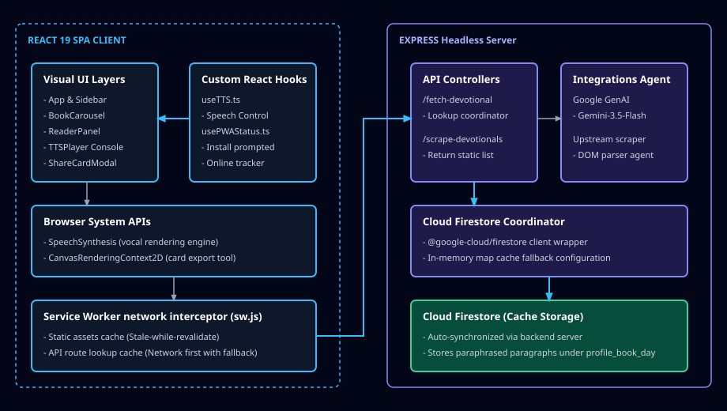
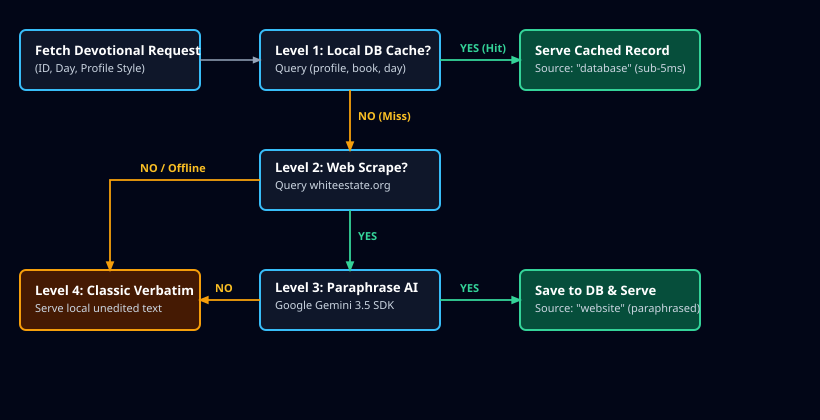

# 📖 Daily Devotionals Reader

[](https://github.com/JSWilsonX/Daily-Devotional)
[](https://react.dev/)
[](https://www.typescriptlang.org/)
[](https://tailwindcss.com/)
[](https://vite.dev/)
[](https://web.dev/progressive-web-apps/)

An immersive, high-fidelity, **local-first Progressive Web App (PWA)** designed to modernize, translate, and synthesize the 19th-century devotional literature of Ellen G. White. 

Traditional access to these historic theological texts often suffers from readability barriers, particularly for younger demographics unfamiliar with Victorian sentence structures, passive phrasing, and archaic vocabulary. This application bridges this accessibility gap by providing real-time, context-sensitive AI-powered adaptations, high-quality Text-to-Speech (TTS) audio playback, offline-first resilient reading capabilities, habit-forming spiritual streak tracking, and interactive onboarding, packaged as a fully installable PWA.

---

## 📌 Table of Contents

- [📖 Daily Devotionals Reader](#-daily-devotionals-reader)
  - [📌 Table of Contents](#-table-of-contents)
  - [🚀 Key Features](#-key-features)
  - [🛠️ Technology Stack](#️-technology-stack)
  - [🏗️ Application Architecture](#️-application-architecture)
    - [Architecture Blueprint](#architecture-blueprint)
    - [Deterministic 4-Tier Data Pipeline](#deterministic-4-tier-data-pipeline)
  - [📁 Project Structure](#-project-structure)
  - [⚙️ Prerequisites](#️-prerequisites)
  - [💻 Local Development Setup](#-local-development-setup)
    - [1. Obtain the Source Code](#1-obtain-the-source-code)
    - [2. Install Project Dependencies](#2-install-project-dependencies)
    - [3. Configure Environment Variables](#3-configure-environment-variables)
    - [4. Launch the Local Development Server](#4-launch-the-local-development-server)
  - [🏃 Running the Application](#-running-the-application)
    - [Development Execution](#development-execution)
    - [Production Build \& Deployment](#production-build--deployment)
    - [Docker Containerized Run](#docker-containerized-run)
  - [🧪 Automated Test Suite](#-automated-test-suite)
    - [Running the Tests](#running-the-tests)
    - [Test Organization Hierarchy](#test-organization-hierarchy)
  - [🔄 Development Workflow](#-development-workflow)
  - [🔧 Important Configuration Reference](#-important-configuration-reference)
  - [⚠️ Troubleshooting \& Edge Cases](#️-troubleshooting--edge-cases)
  - [💾 Database \& Migration Utilities](#-database--migration-utilities)
  - [📚 Additional Documentation](#-additional-documentation)
  - [🤝 Contributing \& Conventions](#-contributing--conventions)

---

## 🚀 Key Features

*   **📚 22-Book Devotional Catalog & Covers**: A beautiful, responsive book carousel showcasing 22 standard Ellen G. White daily devotional titles, featuring rich descriptions, web links, and beautiful fallback CSS-gradient visual styles for offline resilience.
*   **🤖 6 AI-Powered Reading Comprehension Profiles**: Real-time content adaptations matching different reading preferences and audiences, utilizing server-side execution of the Google Gemini Flash model with strict schema enforcement:
    1.  **Classic / Original**: Verbatim 19th-century prose.
    2.  **Clear & Modern**: Respectful, active-voice contemporary phrasing for professional adults.
    3.  **Easy Reading**: Simplified vocabulary, shorter sentences, and abstract metaphor translations.
    4.  **Young Adult**: Conversational, intellectually engaging reframings matching collegiate dynamics.
    5.  **Teens & Youth**: Mentoring tone connecting spiritual topics with student-focused real-world experiences.
    6.  **Kids & Primary**: Highly visual, story-driven narratives focused on concrete home and school lessons.
*   **🔊 Vocal Stream Text-to-Speech (TTS)**: Direct integration with the browser's Web Speech API to provide audio narration. Features regex-driven scripture verbalization (converting verse numbers into spoken phrases like *"First Timothy chapter six, verses nine and ten"*) and context-aware character-by-character replacements of homograph spelling traps (e.g. `LIVE_VERB` $\rightarrow$ *"liv"* vs. `LIVE_ADJECTIVE` $\rightarrow$ *"live"*).
*   **📶 Offline-First & Resilient Design**: Complete Service Worker implementation (`sw.js`) that intercept network requests, cache static resources using a *stale-while-revalidate* strategy, and support comprehensive **365-day offline downloading** per book to ensure disconnected readability.

*   **🔥 Spiritual Streak & Habit Tracking**: Native browser local storage integration tracking daily reading streaks. Completed daily readings increment the streak, multiple reads on the same day are handled idempotently, and streaks reset to `0` if more than 24 hours pass. All habit data is strictly client-side to respect user privacy.
*   **🎨 Canvas Share Card Studio**: Interactive modal that draws custom image quote cards onto an offscreen HTML5 canvas using configured background presets, responsive word-wrapping, and gradient scrims. Supports aspect-ratio toggles (`1:1` square vs `9:16` vertical stories) and integrates with the Web Share API or falls back to system clipboard copies under CORS blockades.
*   **🧭 Guided Onboarding Tour**: A context-sensitive, multi-step interactive onboarding overlay that auto-triggers for first-time visitors and handles viewport size adaptively.
*   **🌗 Contrast-Compliant Theme Modes**: Instant toggling between **Twilight Slate** (high-contrast dark mode) and **Warm Cream** (traditional book-paper style), strictly satisfying WCAG AA standards (contrast $\ge 4.5:1$) with minimum 44px responsive click targets.

---

## 🛠️ Technology Stack

| Layer | Technology | Version | Purpose / Description |
| :--- | :--- | :--- | :--- |
| **Frontend Framework** | React | `19.0.1` | Main Single Page Application (SPA) shell, state management |
| **Styling Engine** | Tailwind CSS v4 | `^4.1.14` | High-performance, modern utility-first responsive styling |
| **Build & HMR Tool** | Vite | `^6.2.3` | Bundling, assets compilation, fast development serving |
| **Animations** | Motion | `^12.23.24` | Fluid UI layout transitions, gestures, and tour overlay animations |
| **Icon Set** | Lucide React | `^0.546.0` | Clean vector UI interface indicators |
| **Backend Runtime** | Node.js | `v22` (slim) | Server execution environment |
| **Server Framework** | Express | `^4.21.2` | Headless routing, scraping, securing Gemini communication |
| **Cloud Database** | Firestore | `^9.0.1` | Cloud Firestore database client for caching and content synchronization |
| **AI Integration** | Google GenAI | `^2.4.0` | Official client library for Google Gemini Flash API calls |
| **Testing Engine** | Vitest | `^4.1.11` | Modern test runner matching Vite alias configuration |
| **DOM Mocking** | JSDOM & RTL | `^30.0.1` | Simulating window interfaces, Web Speech API, and canvas |

---

## 🏗️ Application Architecture

The application implements a decoupled, local-first Client-Server architecture. The server serves as an Express proxy and caching coordinator, while the client operates as a rich React SPA managing persistent state, audio playback queues, visual canvas rendering, and offline database caching.

### Architecture Blueprint

The high-level visual architecture is illustrated below:



*   **Interactive Design Specifications**: Additional detailed blueprints can be viewed directly:
    *   [System Context Diagram](docs/diagrams/system-context.svg) - Explains boundaries and external network interactions.
    *   [User Reading Workflow](docs/diagrams/user-reading-workflow.svg) - Displays screen navigation logic and visual transitions.

### Deterministic 4-Tier Data Pipeline

Devotional page lookups follow a robust, deterministic fallback chain to maximize uptime and reduce external API dependency:



1.  **Cloud Firestore DB Cache**: Query first. Resolves instantly if the book, day, and requested style have already been generated.
2.  **Upstream Web Scraper**: On a database miss, scrape the authentic, classic page from `whiteestate.org/devotional/` using a timeout-safe HTML parser.
3.  **Server-Side Gemini AI**: Forward scraped paragraph arrays to Google Gemini Flash. The model translates prose using requested style system prompts, preserves paragraph sizing, and extracts homograph pronunciation overrides.
4.  **Verbatim Classic Fallback**: If Gemini quotas are exhausted (429) or the API is unavailable (503), immediately fallback to the authentic classic text, inject an inline warning card to inform the reader, and cache the fallback safely.

---


## 📁 Project Structure

```
Daily-Devotional/
├── .github/                 # GitHub workflows and actions
├── assets/                  # Branding and design materials
├── dist/                    # Compiled production-ready static assets
├── docs/                    # Authoritative specifications and documentation
│   ├── diagrams/            # Architecture, pipeline, and workflow diagrams (SVG)
│   ├── daily-devotional-spec.md  # Primary functional & non-functional spec
│   ├── test-architecture-and-coverage.md  # Detailed test execution architecture
│   └── test-coverage-matrix.md   # Behavioral verification matrix
├── public/                  # Static assets distributed with the app shell
│   ├── favicon.svg          # Application logo
│   ├── manifest.json        # PWA metadata configuration file
│   └── sw.js                # Core Service Worker (Offline caching strategy)
├── scripts/                 # Administration and setup automation utilities
│   ├── build_db.py          # Python metadata construction script
│   └── migrate_to_firestore.ts # Admin tool for batch ingest of zipped data
├── src/                     # React Application Root
│   ├── components/          # Encapsulated React Presentation UI
│   │   ├── Tour/            # Interactive Guided Tour Overlay subsystems
│   │   ├── BookCover.tsx    # Book binding cover and caching status indicator
│   │   ├── CalendarPicker.tsx # Date traversal popup selector
│   │   ├── ReaderPanel.tsx  # Dynamic reader panel with live paragraph highlight
│   │   ├── ShareImageCardModal.tsx # Offscreen canvas generator
│   │   └── TTSPlayer.tsx    # Vocal audio control dashboard
│   ├── config/              # Declarative app structures
│   │   └── devotionals.ts   # Catalog mapping, replacements, and voice configs
│   ├── hooks/               # Custom modular lifecycle hooks
│   │   ├── usePWAStatus.ts  # Manifest interceptor & installation prompts
│   │   └── useTTS.ts        # SpeechSynthesis state-machine and queue tracker
│   ├── tests/               # 14 Automated Vitest suites matching source folders
│   ├── types/               # Core global TypeScript interface definitions
│   └── utils/               # General utility libraries
│       ├── date.ts          # ISO formatting & streak calculations
│       └── text.ts          # Homograph overrides & scripture speech verbalization
├── zips/                    # Pre-computed compressed JSON books for batch database seeding
├── Dockerfile               # Node-slim Docker container configuration
├── package.json             # NPM dependencies & task runners
├── server.ts                # Express backend server with Vite integration middleware
├── tsconfig.json            # Compiler configuration for TypeScript compilation
├── vite.config.ts           # Development HMR server and build pipeline configs
└── vitest.config.ts         # Testing runner configurations
```

---

## ⚙️ Prerequisites

To run or build this application locally, ensure you have the following:
*   **Node.js**: `v20.x` or `v22.x` (recommended)
*   **Package Manager**: `npm` (bundled with Node.js)
*   **Operating System**: Windows, macOS, or Linux
*   **Web Browser**: Standard modern browser (Chrome, Edge, Safari, Firefox) with Web Speech Synthesis support.

---

## 💻 Local Development Setup

Follow these simple steps to run the application on your local machine:

### 1. Obtain the Source Code
Clone the repository and navigate into the project directory:
```bash
git clone https://github.com/JSWilsonX/Daily-Devotional.git
cd Daily-Devotional
```

### 2. Install Project Dependencies
Run npm to install all core dependencies and developer tools:
```bash
npm install
```

### 3. Configure Environment Variables
Create a `.env` file in the root folder of the project. You can copy the structure from `.env.example`:
```bash
cp .env.example .env
```
Open `.env` and fill in the required keys:
```env
# Google Gemini API Key - Required for AI paraphrasing.
# Get a key from Google AI Studio: https://aistudio.google.com/
GEMINI_API_KEY="YOUR_ACTUAL_GEMINI_API_KEY"

# Optional App URL and PORT (defaults to 3000 if not specified)
PORT=3000
APP_URL="http://localhost:3000"

# Optional Cloud Firestore configuration for running the app locally referencing cloud firebase.
GOOGLE_CLOUD_PROJECT="YOUR_GOOGLE_CLOUD_PROJECT_ID"
DATABASE_ID="(default)"
```
> 💡 **Zero-Config Option**: If you do not have a `GEMINI_API_KEY`, the application will still launch and remain fully functional. It will seamlessly fallback to displaying the classic verbatim devotional and bypass the Gemini API.

### 4. Launch the Local Development Server
Launch the unified server using the dynamic Express + Vite HMR middleware:
```bash
npm run dev
```
Open your browser and navigate to:
**`http://localhost:3000`**

---


## 🏃 Running the Application

### Development Execution
The development script uses `tsx` to run the Express backend on `server.ts`. If in development mode, Express launches a programmatically mounted **Vite Development Server** using `createViteServer`. This ensures single-port simplicity: both backend endpoints (`/api/*`) and hot-module frontend updates are served together at `http://localhost:3000`.
```bash
npm run dev
```

### Production Build & Deployment
For staging and production deployment, compile the application into fully optimized, bundled assets:
1.  **Build Assets**:
    ```bash
    npm run build
    ```
    This script runs `vite build` (compiling frontend scripts into `/dist`) and compiles `server.ts` into a lightweight, standalone production file `/dist/server.cjs` using `esbuild`.
2.  **Start Web Server**:
    ```bash
    npm start
    ```
    This runs the application in headless production mode on port `3000` (or your configured `PORT` env variable) and serves optimized static pages.

### Docker Containerized Run
This repository includes a lightweight, secure `Dockerfile` based on `node:22-slim`:
```bash
# Build Docker Image
docker build -t daily-devotional .

# Run Containerized Server (maps default container port 3000 to host port 3000)
docker run -d -p 3000:3000 --env-file .env daily-devotional
```

---

## 🧪 Automated Test Suite

The project includes an extensive, fully verified automated test suite of **91 tests** checking all business rules, edge cases, integration workflows, and API paths.

### Running the Tests
*   **Run Single Pass Execution**:
    ```bash
    npm test
    ```
*   **Run Vitest Watch Mode**:
    ```bash
    npm run test:watch
    ```
*   **Generate Code Coverage**:
    ```bash
    npx vitest run --coverage
    ```
*   **Execute a Specific Test File**:
    ```bash
    npx vitest run src/tests/utils/date.test.ts
    ```
*   **Execute Tests matching a Keyword**:
    ```bash
    npx vitest run -t "streak"
    ```

### Test Organization Hierarchy
The test suites are logically categorized inside `src/tests/` to guarantee absolute stability across critical boundaries:
1.  **Core Unit Utilities** (`src/tests/utils/`, `src/tests/config/`): Verifies formatting mathematics, scripture citation parsing, single-chapter book bounds, and cover gradient configs.
2.  **Habit & Streak Math** (`src/tests/utils/date.test.ts`): Protects timezone drift, verifies Yesterday + Today increment, ensures same-day idempotency, and verifies corrupted database recovery.
3.  **Vocal Speech State Machine** (`src/tests/hooks/useTTS.test.ts`): Simulates audio synthesis lifecycle hooks: `Idle` $\rightarrow$ `Playing` $\rightarrow$ `Paused` $\rightarrow$ `Resumed` $\rightarrow$ `Stopped`.
4.  **Guided Onboarding Tours** (`src/tests/components/Tour.test.tsx`): Verifies step navigation overlay prompts and version-gate checks.
5.  **Graphics customizer** (`src/tests/components/ShareImageCardModal.test.tsx`): Tests offscreen canvas size adjustments, word-wrap layout scripts, and clipboard fallbacks.
6.  **Server API Resilience** (`src/tests/server/`): Simulates scraper mocks, Gemini rate limits (429/503), Firestore cache hits, and malformed JSON repair algorithms.
7.  **E2E Workflow Integrations** (`src/tests/integration/`): Fully integrates components, rendering style switching, date traversals, offline pre-caching, and network recovery actions.

---

## 🔄 Development Workflow

To maintain the high quality and robustness of the codebase, please conform to this step-by-step developer loop:

```
[Create Feature Branch] 
       │
       ▼
[Develop Changes] ──► [Verify Types & Linting] (npm run lint)
       │
       ▼
[Execute Targeted Tests] (npx vitest run <file>)
       │
       ▼
[Execute Complete Test Suite] (npm test)
       │
       ▼
[Build Production Distribution] (npm run build)
       │
       ▼
[Deploy / Pull Request]
```

---


## 🔧 Important Configuration Reference

*   **`package.json`**: Controls core dependencies, bundling, test runners, and standard NPM build/start actions.
*   **`vite.config.ts`**: Handles client-side bundle configurations, allowed hosts, and contains custom safety parameters (`DISABLE_HMR`) to disable active file watchers and save CPU cycles on cloud agents.
*   **`vitest.config.ts`**: Configures Vitest settings, JSDOM environment, mocked setup file registration, and coverage settings.
*   **`tsconfig.json`**: Sets TS compiler options. Strict mode is active, checking formatting types, absolute paths (`@/*`), and preventing global omissions.
*   **`public/sw.js`**: Core Progressive Web App Service Worker. Defines stale-while-revalidate caches for static shells and network-first strategies for backend scraping/translation APIs.
*   **`.env.example`**: Clean blueprint of necessary credentials. Never commit your personal secrets to git.

---

## ⚠️ Troubleshooting & Edge Cases

### Firestore Credential Warnings
At boot, the server attempts to establish a Cloud Firestore connection. If credentials are missing, you will see:
`[Database Warning] Firestore credentials not loaded. Saved to in-memory fallback only.`
*   **Action Needed**: This is fully expected in localized developer runtimes. The backend automatically mounts an in-memory cache fallback to continue working seamlessly without any cloud dependencies.

### Gemini API 429 & 503 Outages
If your Google Gemini key reaches daily limits or experience high load, you will notice warning banners:
`The daily AI translation quota is currently fully exhausted.` or `The Gemini AI service is currently experiencing high demand.`
*   **Action Needed**: No developer actions required. The frontend intercepts these responses to display classic text verbatim, rendering a notice without breaking the single page container layout.

### Speech Audio Engine Silent in Tests
*   The automated test suite runs in **JSDOM** which does not implement native OS sound components. As such, Vitest mocks the window.speechSynthesis and SpeechSynthesisUtterance interfaces. If audio doesn't play during local browser testing, verify your browser has native TTS permissions enabled.

### Offline Book Cache Loops
*   Pre-caching a whole 365-day booklet requests files in sequential chunks. If the pre-cache progress bar freezes or loops, click the **Cancel** button. The hook will trigger an abort controller and cancel active requests immediately, avoiding browser network pollution.

---

## 💾 Database & Migration Utilities

To seed or migrate database structures, this repository includes:
*   **`scripts/migrate_to_firestore.ts`**: An administrator utility that reads pre-processed JSON records zipped inside the `/zips/` folder (such as `clear_modern.zip`, `easy_reading.zip`, `kids_primary.zip`) and bulk-ingests them directly into your Cloud Firestore collection. 
*   **Execution**:
    To run this script directly, execute:
    ```bash
    npx tsx scripts/migrate_to_firestore.ts
    ```
    Ensure you have authenticated Google Cloud credentials (`GOOGLE_APPLICATION_CREDENTIALS` environment variable set) or are running in an authorized GCP compute environment.

---

## 📚 Additional Documentation

For deeper insight into design specification and technical testing methodologies, read the detailed guides inside the `/docs` directory:
1.  **[Requirements, Architecture, and Design Specification](docs/daily-devotional-spec.md)**: The definitive source of truth outlining the visual styling guide, UI/UX dimensions, translation styles, Web Speech API pronunciations, and offline pre-caching behaviors.
2.  **[Test Architecture and Coverage Strategy](docs/test-architecture-and-coverage.md)**: A complete explanation of mock setups, testing guidelines, and regression risk analysis.
3.  **[Comprehensive Test Coverage Matrix](docs/test-coverage-matrix.md)**: Tabular behavioral requirement map showing exactly where and how each application feature is covered in the automated tests.

---

## 🤝 Contributing & Conventions

Please follow these conventions when making contributions to this repository:
*   **Isolated Namespacing**: All properties saved to local storage must use the `egw_` prefix namespace to prevent key collisions with other local domains (e.g. `egw_streak`, `egw_theme`).
*   **Touch Targets**: Keep all buttons and input handles at a minimum size of `44px x 44px` to fulfill mobile accessibility principles.
*   **CORS Compliance**: Images imported to the canvas quote customizer must request cross-origin anonymity (`img.crossOrigin = "anonymous"`) to ensure browser security models are respected and prevent canvas taints.
*   **No Code Omissions**: When refactoring components, ensure they remain complete. Do not substitute actual code with comments or empty placeholders.

