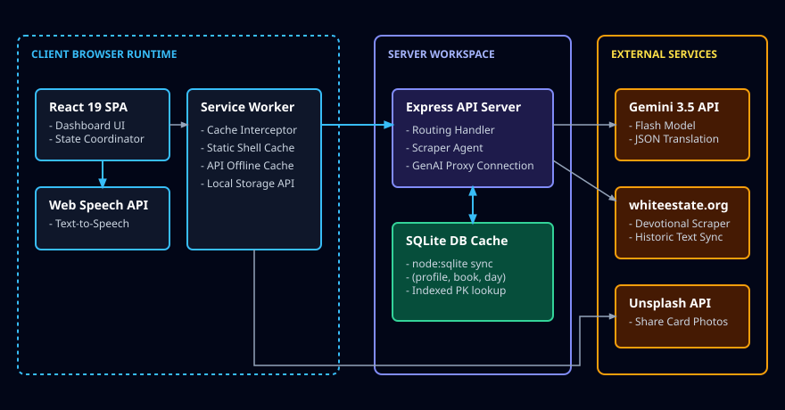
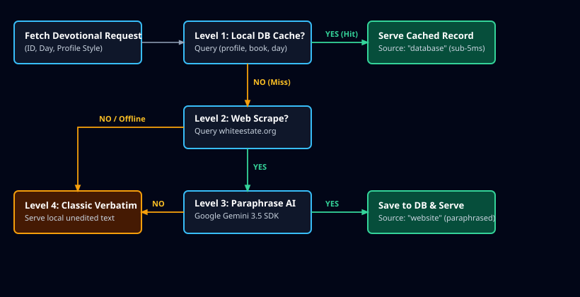
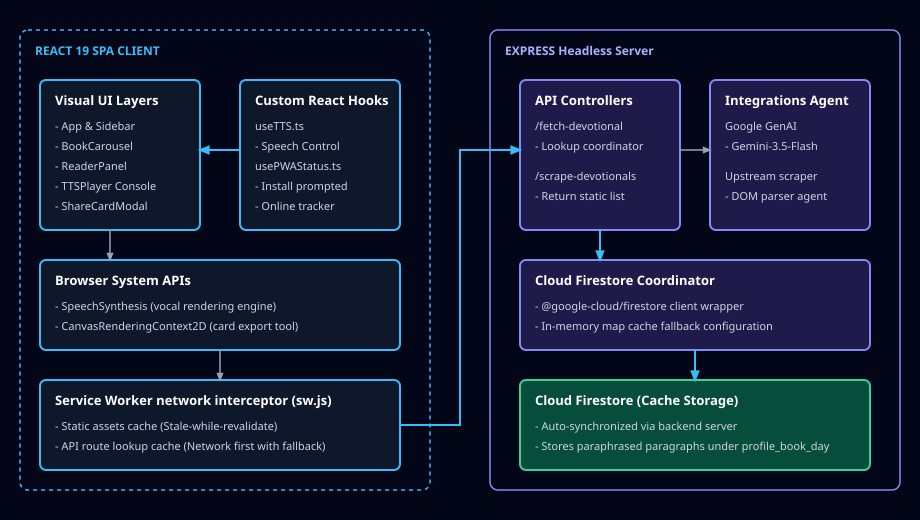
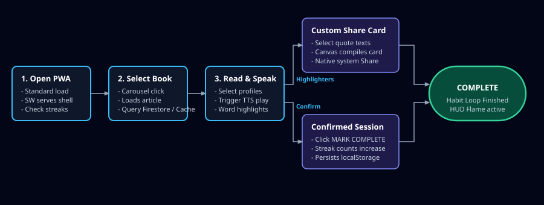
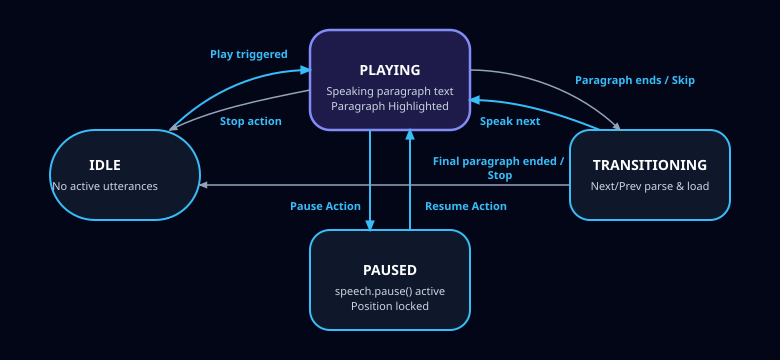
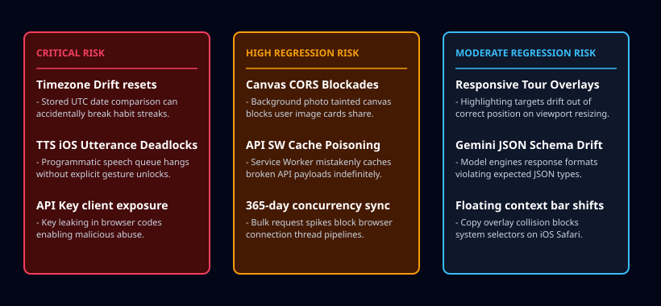
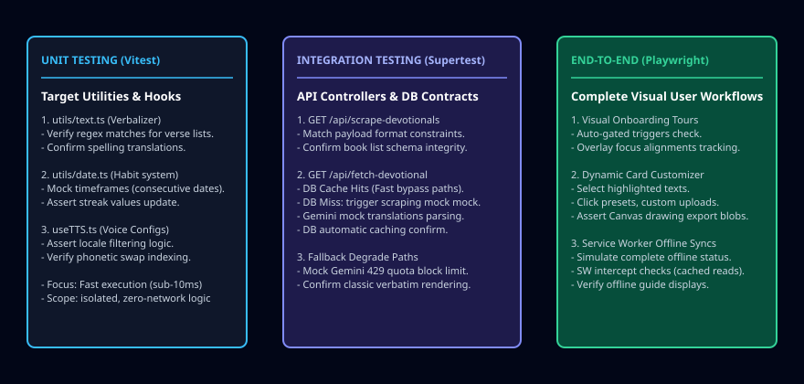

# Daily Devotionals Reader: Requirements, Architecture, and Design Specification

---

## 1. Executive Summary

The **Daily Devotionals Reader** is an immersive, high-fidelity, local-first web application designed to modernize, translate, and synthesize the 19th-century devotional literature of Ellen G. White. Traditional access to these historic theological texts often suffers from readability challenges, particularly for younger demographics (collegiate, youth, and children) unfamiliar with Victorian-era sentence structures, passive phrasing, and archaic vocabulary. This application bridges this accessibility gap by providing real-time, context-sensitive AI-powered adaptations, high-quality Text-to-Speech (TTS) audio playback, offline-first reading capability, habit-forming spiritual streak tracking, and interactive onboarding, packaged as a fully installable Progressive Web App (PWA).

### Architectural Core Principles
1. **Local-First & Offline Resilient**: Core assets and static application shells are served via Service Workers using stale-while-revalidate strategies. Network connections are treated as an enhancement rather than a dependency.
2. **Deterministic 4-Tier Data Pipeline**: Devotional lookups execute through a highly resilient fallback chain: Cloud Firestore Database Cache -> Upstream Web Scraper -> Server-Side Gemini AI Paraphrasing -> Verbatim Classic Fallback with custom runtime error warnings.
3. **Structured AI Paraphrasing**: Paraphrasing is performed using high-speed, server-side execution of the Google Gemini 3.5 Flash model with strong schema enforcement, structured JSON responses, custom system instructions, and dynamic pronunciation overrides.
4. **Vocal Stream Playback**: Integrates directly with the browser's Web Speech API, featuring regex-driven scripture verbalization (converting verse citations into natural spoken words) and phonetic character-by-character replacements to bypass synthesis errors.
5. **Interactive Onboarding Subsystem**: A conditional, multi-step onboarding and update-gated guided tour that dynamically adapts to mobile viewport constraints and nests automatically under fallback UI paths when elements are hidden.

---

## 2. Application Purpose and Scope

### Purpose
The primary purpose of the Daily Devotionals Reader is to preserve the profound spiritual depth and theological integrity of Ellen G. White’s daily devotionals while adapting their presentation to match the reading comprehension level, tone preference, and lifestyle patterns of modern audiences. 

The application resolves three classic digital reading barriers:
- **Linguistic Barrier**: Translates 19th-century prose into five customized modern reading styles without altering underlying theological or scriptural meaning.
- **Connectivity Barrier**: Provides comprehensive offline pre-caching for up to 365 days of reading material per book to accommodate remote or network-isolated settings.
- **Retention & Engagement Barrier**: Utilizes audio-driven text highlighting, gamified habit tracking (streaks), and customized aesthetic quote card generation to encourage regular engagement and social sharing.

### System Scope and Boundaries



1. **Client Sandbox**: Runs within standard modern browser runtimes (Chrome, Safari, Edge, Firefox, iOS/Android WebViews). Utilizes native HTML5 Canvas for graphics, standard localStorage for client state, and the Web Speech API for voice generation.
2. **Backend Server Layer**: Hosted as a Node.js Express server. Responsible for initiating database connections, parsing the Cloud Firestore devotional cache, executing target web scraping requests, and proxying communication securely with the Google GenAI endpoints.
3. **External Dependencies**:
   - **Google Gemini API**: Accessible only via the backend server-side proxy to protect API keys. Paraphrases raw text and supplies structured pronunciation JSON data.
   - **Upstream Web Server (`whiteestate.org`)**: Queried on-demand when a local Cloud Firestore database cache miss occurs.
   - **Unsplash CDN**: Serves high-resolution background photography for share card creation.

---

## 3. Functional Requirements Specification

### FR-1: Devotional Catalog & Book Navigation
- **Description**: The application must display a curated collection of 22 devotional books written by Ellen G. White.
- **Business Rationale**: Provides users with a structured theological library spanning distinct themes (e.g., Christ's character, grace, salvation history, and personal growth).
- **Core Rules**:
  - The default collection contains exactly 22 books represented by specific 3-letter IDs: `ohc`, `fh`, `ul`, `tmk`, `rc`, `ctr`, `cc`, `ag`, `hp`, `lhu`, `mar`, `mlt`, `ofc`, `blj`, `flb`, `hb`, `rre`, `sd`, `tdg`, `wgd`, `yrp`, `jnn`.
  - Book covers must first attempt to load high-resolution image resources via static URLs.
  - **Procedural Cover Fallback**: If an image URL fails to resolve, or when offline and the asset is uncached, the application must generate a procedural, styled visual cover utilizing CSS gradient maps mapped to the book's unique ID, showing the book's title and its ID abbreviation.
  - **Dynamic Sorting Heuristic**: Book catalog cards are ordered in the library carousel according to a deterministic layout algorithm. The currently selected book is pinned first. Remaining books are sorted by unread status relative to the current day, based on the order defined in `UNREAD_BOOKS_ORDER`, followed by alphabetical sorting of book titles.

### FR-2: Multi-Profile Translation Engine
- **Description**: The system must provide six selectable profile styles that dynamically modify the prose, tone, complexity, and presentation of the active devotional reading.
- **Business Rationale**: Maximizes age-appropriate reading engagement while keeping theological views strictly intact.
- **Available Profiles**:
  1. **Classic / Original (`classic` / `original`)**: Verbatim, unedited 19th-century Victorian English text.
  2. **Clear & Modern (`clear_modern`)**: Dignified, respectful, and articulate modern adult English with simplified sentence structures and smooth phrasing.
  3. **Easy Reading (`easy_reading`)**: Simple, direct, and encouraging tone using highly accessible vocabulary, short active-voice structures, and literal representations of abstract metaphors.
  4. **Young Adult (`young_adult`)**: Authentic, conversational, raw, and intellectually challenging adaptation that reframes spiritual themes around modern culture, ethics, social media, and personal identity.
  5. **Teens & Youth (`teens_youth`)**: Dynamic, empathetic, direct, and mentoring perspective that maps abstract spiritual lessons into modern teenager experiences like peer comparison and academic self-worth.
  6. **Kids & Primary (`kids_primary`)**: Story-driven, enthusiastic, and highly visual text translating complex theological concepts into concrete stories about kindness, sharing, and home choices.

### FR-3: Devotional Fetching & 4-Tier Fallback Pipeline
- **Description**: The application must fetch and parse the text content of the active devotional book for the target calendar date through a resilient fallback chain.
- **Input Parameters**: `book_id` (string), `day` (string formatted as `MM_DD`), `profile` (string).
- **Output Schema**: A JSON payload containing:
  - `title` (string): Title of the daily entry.
  - `paragraphs` (array): List of paragraph objects, each containing `id` (string), `type` ("scripture" | "body"), `text` (string), and `pronunciationOverrides` (array).
  - `warning` (optional string): A warning explaining fallback operations or AI constraints.
- **Fallback Execution Sequence**:



### FR-4: Speech Synthesis (TTS) & Phonetic Translation
- **Description**: Text paragraphs must be read aloud with sentence-synchronized text-to-speech audio control.
- **Core Rules**:
  - **Dynamic Voice Profiles**: Audio voice profiles must adjust automatically to the active reading profile (e.g., `classic` uses a slower rate and lower pitch male voice; `kids_primary` uses a standard female voice with higher pitch for excitement).
  - **Pronunciation Override Substitution**: Before injecting text into browser `SpeechSynthesisUtterance`, locate the exact occurrence of ambiguous words and replace them with phonetic values from the dictionary (e.g., `LIVE_VERB` -> `"liv"`, `READ_PAST` -> `"red"`).
  - **Scripture Citations Verbalization**: Scripture references embedded in texts (e.g., `Jeremiah 35:18, 19`, `John 3:16`, `Genesis 1-3`, `Jude 18, 19`) must be parsed using robust, multi-layer regular expressions and converted into natural spoken English (e.g., `"Jeremiah chapter thirty-five, verses eighteen and nineteen"`) before text injection.

### FR-5: Spiritual Habit & Streak Tracking
- **Description**: Tracks user reading frequency and presents consecutive-day streaks in a gamified HUD element.
- **Core Logic**:
  - The streak updates when the user clicks the "MARK COMPLETED" button in the active reader panel.
  - **Consecutive Check**: Let $d_{last}$ be the stored `egw_last_read_date` and $d_{today}$ be the user's localized browser date string (calculated via `YYYY-MM-DD`). 
    - If $d_{today} = d_{last}$, the mark action is idempotent and the streak is unmodified.
    - If the calendar difference between $d_{today}$ and $d_{last}$ is exactly 1 day, the streak increments by 1.
    - If the calendar difference is greater than 1 day, the streak resets to 1 day.
  - Streaks and last read stamps must be persisted locally in `localStorage` under `egw_streak_count` and `egw_last_read_date`.

### FR-6: Calendar-Based Daily Reading Selector
- **Description**: The system must provide a custom date picker popover allowing users to browse devotionals for any day of the year.
- **Core Rules**:
  - The popover must display a grid representing the currently focused month and year.
  - Navigating months must automatically adjust the days-of-month grid count (handling leap years correctly via date-math boundaries).
  - Selecting a date resets the current reading content and prompts the pipeline to fetch the devotional text corresponding to the target month and day.
  - The picker must include a single-button quick reset pointing immediately to the user's local today date.

### FR-7: Offline Reading & 365-Day Pre-Caching Engine
- **Description**: Allows users to download all 365 daily readings for a selected devotional book to their local database cache.
- **Core Rules**:
  - Caching is triggered by clicking the "CACHE" badge on the book cover.
  - **Batch Queue Scraper**: The client must initiate sequential asynchronous fetch requests for all 365 days. To prevent browser connection throttling, requests must execute in parallel batches of exactly 4.
  - **Cancellation Interruption**: The caching pipeline must support user-initiated cancellation. Selecting "CANCEL" must trip an internal `AbortController` signal to immediately stop further batch scheduling.
  - **Visual Telemetry**: Display real-time progress inside a dedicated banner HUD (`CacheProgressBanner`), exposing exact download ratios (`x / 365 days`) and a visual, sliding progress bar track.

### FR-8: Social Reflection Image Card Studio
- **Description**: The application must incorporate a custom modal interface to turn active scriptures or highlighted paragraphs into stylized graphic cards for social media sharing.
- **Core Rules**:
  - **Aspect Ratios**: Supports standard square format (`1:1` at 1080px x 1080px) and vertical story format (`9:16` at 1080px x 1920px).
  - **Background Presets**: Users can select from 6 integrated, high-contrast landscape photography templates or upload custom localized images via a standard file reader.
  - **Graphics Wrapping Engine**: Canvas text rendering must dynamically wrap long paragraphs based on calculated string widths. Font size must dynamically decrease if text overflows the maximum safe-zone vertical bounds of the card container.
  - **Vignette Overlay**: The canvas must render a translucent, rounded-rectangle dark vignette box (`rgba(8, 15, 30, 0.6)`) with a subtle white hairline border behind the quote text to guarantee readability over diverse background designs.
  - **Web Share Integration**: High-resolution canvas images must be exported as native JPEG blobs and shared immediately using the native mobile browser `navigator.share` utility (incorporating the image file and standard reflection text). If the API is unsupported, the system fallback must trigger an automatic JPEG image download while copying the text caption to the clipboard.

### FR-9: Floating Text Selection Toolbar
- **Description**: Highlighting or selecting text within the active devotional reader panel must display a context-sensitive, floating sharing prompt.
- **Core Rules**:
  - **Mobile Collision Evasion**: On mobile and touch viewports, native browsers display default callout bars ("Copy", "Share", "Explain") sitting above the text. The floating sharing button must automatically position itself **below** the selected boundaries (offset by at least 12px) to prevent layout overlapping. If selection sits near the bottom margin of the screen, the button must reposition safely.
  - **Selection Threshold**: Display the button only when text selection length exceeds a minimum of 4 characters. Clicking the sharing button must open the Image Card Studio pre-loaded with the exact highlighted text selection.

### FR-10: Onboarding Guided Tour
- **Description**: First-time application visits must automatically launch an interactive, multi-step onboarding guided tour overlay.
- **Core Rules**:
  - **Version Gating**: The tour launches automatically on startup if `egw_last_completed_tour_version` is missing from `localStorage` (onboarding tour) or is older than the current semver code version (upgrade tour).
  - **Responsive Element Tracking**: Tour overlays must calculate bounds dynamically using `getBoundingClientRect`. If a highlighted control resides offscreen (e.g., bottom playback dock), the tour overlay must scroll the window smoothly to bring it into focus.
  - **Collapsed Control Fallback**: On narrow or mobile screen sizes, some controls are grouped under a generic "More Menu" (•••). If a tour step target is hidden, the system must fallback and point directly to the "More Menu" button, displaying a nested fallback notice.

### FR-11: Responsive UI & Dual Theme Engine
- **Description**: The interface must adjust layout fluidly to mobile, tablet, and desktop viewports and provide two distinct atmospheric presets.
- **Core Rules**:
  - **Twilight Slate (Dark Mode)**: Highly immersive deep blue gradient (`radial-gradient(circle at 50% 10%, #0f172a 0%, #020617 100%)`) accented with ambient cybernetic cyan and warm amber glows.
  - **Warm Cream (Light Mode)**: Calming, high-legibility reading surface utilizing light ivory backdrops (`#FAF7F2`) and deep charcoal sepia text.

---

## 4. Non-Functional Requirements Specification

### Performance & Latency
- **Database Search Latency**: Cloud Firestore database query lookups (point reads via document ID) for cached devotionals must complete in under 50ms in cloud environments, and under 10ms when using the local in-memory fallback.
- **Canvas Processing Speed**: Graphic generation inside the Canvas Image Studio must render in less than 16ms to avoid screen flickering during configuration edits.
- **Speech Initialization**: Native browser Speech Synthesis must start audibly within 150ms of hitting the "Play" action.

### Reliability & Fault Tolerance
- **API Failure Resilience**: If the Google Gemini AI paraphrasing API encounters authorization errors, network disconnection, or rate limit quota exhaustion (status `429`), the backend must recover gracefully. It must serve the unedited classic 19th-century text, and display a temporary explanatory warning badge to the user.
- **Scraper Safety**: Scraping requests pointing to the upstream server must implement a strict 10,000ms abort timeout to prevent network hang.

### PWA & Offline Behavior
- **Asset Caching**: The Progressive Web App must register a Service Worker (`sw.js`) that caches core navigation layouts, static icons, and stylesheets using a Stale-While-Revalidate caching strategy.
- **API Cache Interception**: The Service Worker must intercept GET requests for `/api/fetch-devotional` and execute a Network-First strategy with automatic cache fallback. 
  - If online: Fetch content from API and cache a cloned copy of the response.
  - If offline: Attempt to serve the cloned response from the local Cache storage. If unavailable, return a structured JSON response notifying the application that the devotional is not yet cached.
- **Standalone Launch**: The manifest (`manifest.json`) must comply with standard Android/iOS installation criteria (standalone display mode, maskable icon sets, and standard category definitions).

### Data Integrity & Security
- **Secure Key Management**: The `GEMINI_API_KEY` must remain strictly server-side. Under no circumstances must API keys be transmitted to or stored in client-side storage or headers.
- **Data Encapsulation**: Local storage properties must be neatly isolated under the `egw_` prefix namespace to prevent key collisions with other local domains.
- **CORS Mitigation**: Images imported into the offscreen Canvas Share Card must request cross-origin anonymity (`img.crossOrigin = "anonymous"`) to bypass browser tainted canvas security blockades.

### Usability & Accessibility
- **Responsive Target Dimensions**: To guarantee accessibility, all touch-sensitive controls (buttons, selection boxes) must maintain minimum active clickable dimensions of at least 44px x 44px.
- **Text-to-Background Contrast**: Text elements in both "Twilight Slate" and "Warm Cream" modes must maintain a contrast ratio of at least 4.5:1 relative to their backgrounds (complying with WCAG AA guidelines).
- **Graceful Text Wrapping**: To avoid visual clutter, text inside the reader pane must utilize proportional word-wrapping containers with smooth scrolling mechanisms, and limit maximum text line widths to 70 characters for optimal reading speed.

---

## 5. Application Architecture

The application implements a decoupled, local-first Client-Server architecture. The server acts as a thin proxy, data synchronization node, and caching coordinator, while the client operates as a rich Single Page Application (SPA) managing state, audio streaming, visual rendering, and local persistence.



<!-- OLD ASCII BLOCK
```
+-----------------------------------------------------------------------------------+
|                              REACT 19 CLIENT-SIDE SPA                             |
|                                                                                   |
|  +--------------------+   +-------------------+   +----------------------------+  |
|  |     Component      |   |    Custom Hooks   |   |     Browser Web APIs       |  |
|  | - App, Sidebar     |   | - useTTS          |   | - SpeechSynthesis          |  |
|  | - Header, Carousel |   | - usePWAStatus    |   | - CanvasRenderingContext2D |  |
|  | - ReaderPanel      |   +---------+---------+   | - localStorage             |  |
|  | - ShareCardModal   |             |             +--------------+-------------+  |
|  +---------+----------+             |                            ^                |
|            |                        |                            |                |
|            v                        v                            v                |
|  +-----------------------------------------------------------------------------+  |
|  |                             Service Worker (sw.js)                          |  |
|  |               (Interceptors, Static Assets & API Cache Fallbacks)           |  |
|  +--------------------------------------+--------------------------------------+  |
+-----------------------------------------|-----------------------------------------+
                                          | HTTP REST
                                          v
+-----------------------------------------------------------------------------------+
|                               EXPRESS Headless Server                             |
|                                                                                   |
|  +------------------------------------+   +------------------------------------+  |
|  |            API Routing             |   |        Database Synchronization    |  |
|  | - /api/scrape-devotionals          |   | - Node.js node:sqlite DatabaseSync |  |
|  | - /api/fetch-devotional            |   | - 3-tuple PK (profile, book, day)  |  |
|  +-----------------+------------------+   +-----------------+------------------+  |
|                    |                                        |                     |
|                    v                                        v                     |
|  +------------------------------------+           +-------------------+           |
|  |       Google GenAI Integration     |           |    devotionals.db |           |
|  | - Gemini-3.5-Flash Prompt System   |           |    (SQLite File)  |           |
|  +-----------------+------------------+           +-------------------+           |
+--------------------|--------------------------------------------------------------+
                     v
+-----------------------------------------------------------------------------------+
|                                 External Cloud                                    |
|                                                                                   |
|        +------------------------+           +------------------------+            |
|        |    Google Gemini API   |           |   whiteestate.org Web  |            |
|        +------------------------+           +------------------------+            |
+-----------------------------------------------------------------------------------+
-->

### Architectural Subsystems
1. **Headless Express Backend**: Employs an Express Node.js engine that implements HTTP REST interfaces for static listings and proxying requested daily devotionals.
2. **Local Caching Layer**: Implemented using Google Cloud Firestore (leveraging dynamic Application Default Credentials) with an automated local in-memory fallback. It acts as an indexed storage engine matching translations on the exact primary key 3-tuple document ID `${profile_id}_${book_id}_${day}`.
3. **Google Gemini Translation Engine**: Leverages the official Google GenAI package to execute modern professional paraphrasing at the server layer, hiding API secrets and enforcing JSON structured response contracts on the client's behalf.
4. **Service Worker Interceptor Network**: A robust client-side network interceptor (`sw.js`) utilizing static caching for UI elements and Cache Storage fallback routes for custom server API requests.
5. **Aether UI SPA Layer**: Built with React 19, Tailwind CSS, Lucide icons, and Motion, presenting reactive interfaces for book browsing, calendar navigation, streak counters, offscreen canvas graphics generation, and vocal feedback players.

---

## 6. Component and Module Design

The client-side React SPA is structured as modular, reusable components with explicit state, property contracts, and reactive DOM interfaces.

### Core Frontend Modules

#### `App.tsx` (Dashboard Coordinator)
- **Responsibility**: Orchestrates the global application state including selection hooks, visual theme states, offline cache banners, and modal triggers.
- **Key States**:
  - `selectedId` (string | null): Active book ID, synchronized with local storage.
  - `content` (DevotionalContent | null): Decoded JSON devotional payload.
  - `selectedProfile` (string): Active translation profile style.
  - `selectedDate` (Date): Selected day for reading navigation.
  - `streakCount` (number): Dynamic calculated reading streak count.
  - `cacheProgress` (CacheProgressState): Progress tracking metadata during book downloads.

#### `Header.tsx` (HUD Control Console)
- **Properties**: `isSlate`, `isOnline`, `streakCount`, `hasCompletedToday`, `selectedDate`, `selectedProfile`.
- **Interactions**: Hosts dropdown switches to toggle the translation style, displays the spiritual streak badge, and triggers calendar picker states. On mobile viewports, responsive layouts collapse secondary actions into a contextual floating `More Options` menu.

#### `DevotionalCarousel.tsx` (Visual Catalog)
- **Properties**: `sortedDevotionals`, `selectedIdx`, `cachedBookIds`, `isBookReadToday`.
- **Interactions**: Displays book covers horizontally. Controls left/right sliding triggers using horizontal offset scrolls (`scrollBy({ left: ... })`). Passes selection indices up to `App.tsx` coordinator.

#### `BookCover.tsx` (Procedural Asset Renderer)
- **Properties**: `title`, `coverUrl`, `bookId`, `isCachedOffline`, `isReadToday`.
- **State**: `imageError` (boolean), `showMenu` (boolean).
- **Behavior**: Renders static book covers via URL. If loading fails or is offline, switches immediately to render a styled, dual-tone CSS gradient based on hardcoded color dictionaries associated with specific `bookId` patterns. Incorporates quick controls to download ("CACHE") or delete local book caches.

#### `ReaderPanel.tsx` (Aesthetic Reading Canvas)
- **Properties**: `content`, `activeParagraphIdx`, `hasCompletedToday`, `isBookReadToday`.
- **Behavior**: Displays parsed title and scriptural text. Employs a dynamic highlighting system that highlights the active reading paragraph (`activeParagraphIdx`) with cyan overlays and glows. Hosts the "MARK COMPLETED" trigger button.

#### `TTSPlayer.tsx` (Vocal Playback Dock)
- **Properties**: `isPlaying`, `isPaused`, `activeParagraphIdx`, `speechRate`, `voices`.
- **Interactions**: Provides audio standard controls: Play, Pause, Stop, Skip Forward, Skip Backward. Displays selected voice configurations and exposes speed playback sliders.

#### `ShareImageCardModal.tsx` (Graphic Synthesis Engine)
- **Properties**: `isOpen`, `initialText`, `bookTitle`, `dateStr`.
- **States**: `quoteText`, `reflectionText`, `aspectRatio`, `selectedTemplate`, `customImage`.
- **Behavior**: Coordinates Canvas context interactions. Preloads background textures, executes text word-wrapping equations, computes vertical bounding boxes to prevent overflow, draws translucent glass scrim cards, and hooks into `navigator.share` or fallback asset download scripts.

### Custom Hooks & Utility Modules

#### `useTTS.ts` (Web Speech API Bridge)
- **Responsibility**: Exposes simple state methods to interact with native Speech Synthesis. Coordinates automatic sequential progression, reading paragraph text, substituting ambiguous phonetic tokens, verbalizing scripture references, and invoking completion callback scripts.

#### `usePWAStatus.ts` (PWA Installer and Network Agent)
- **Responsibility**: Tracks browser-fired `beforeinstallprompt` events, exposes installation methods (`handleInstallPWA`), and listens to window `online`/`offline` state changes to notify components.

#### `utils/text.ts` (Scripture Verbalizer)
- **`verbalizeScripture(text: string)`**: Parses bible strings using deep regex and replaces them with longspoken word strings.
- **`replaceNthWord(text, word, n, replacement)`**: Locates the exact occurrence of a target substring within a paragraph and executes localized letter substitutions without breaking the rest of standard text parameters.

#### `utils/date.ts` (Streak & Calendar Utilities)
- **`calculateInitialStreak()`**: Evaluates local state upon initial load, checking for timezone gaps to decide if the streak is still active or has broken.
- **`getLocalDateString(Date)`**: Formats dates deterministically into standard `YYYY-MM-DD` strings, preventing timezone drift.

---

## 7. Data Architecture and Persistence Contracts

The application utilizes dual-persistence zones: a structured Cloud Firestore database cache on the server-side (with an intelligent local in-memory fallback for offline/development environments), and key-value browser storage on the client-side.

### Cloud Firestore Database Cache Layout
The system connects to Google Cloud Firestore and maintains an indexed collection named `devotionals`.

#### Document ID Strategy
To achieve **O(1) direct point reads** (Firestore's lowest-latency and most cost-effective fetch route), document IDs are composed deterministically using the primary key 3-tuple pattern:
```
Document ID: ${profile_id}_${book_id}_${day}
(e.g., "clear_modern_ohc_01_01" or "original_ag_12_31")
```

#### Document Schema Layout
Each document in the `devotionals` collection has the following structure:
```json
{
  "profile_id": "string",       // Active style profile mapping (e.g., "clear_modern", "original")
  "book_id": "string",          // 3-letter, lower-cased book abbreviation (e.g., "ohc", "fh")
  "day": "string",              // Calendar day formatted strictly as "MM_DD" (e.g., "01_01")
  "title": "string",            // Paraphrased or classic title
  "paragraphs": "Array<Object>",// Structured paragraphs (id, type, text, pronunciationOverrides)
  "updatedAt": "string",        // ISO timestamp
  "createdAt": "string"         // ISO timestamp
}
```

#### Fields & Data Verification Matrix
- `profile_id` (string): Active style profile mapping. Standard normalized keys are `"original"` (Classic/Original), `"clear_modern"`, `"easy_reading"`, `"young_adult"`, `"teens_youth"`, and `"kids_primary"`.
- `book_id` (string): 3-letter, lower-cased book abbreviation (e.g., `"ohc"`, `"fh"`, `"ul"`).
- `day` (string): Structured calendar day of the year formatted strictly as `MM_DD` (e.g., `"01_01"`, `"06_30"`, `"12_31"`).
- `title` (string): Paraphrased or classic title.
- `paragraphs` (array of maps): Structured paragraph entries, containing properties `id`, `type` (`"scripture"` or `"body"`), `text`, and `pronunciationOverrides`. No JSON double-escape parsing required, as Firestore handles complex structures natively.

---

### Browser State Persistence (LocalStorage Contract)
Client state is isolated within the browser local storage namespace using strict key naming patterns.

| Storage Key | Data Type | Default Value | Synchronization Lifecycle |
|---|---|---|---|
| `egw_selected_devotional_id` | `string` | `null` | Updated instantly when a new catalog book is focused in the carousel. |
| `egw_selected_profile` | `string` | `"clear_modern"` | Updated when the translation dropdown selection changes. |
| `egw_streak_count` | `number` | `0` | Incremented when marking reading completion on a consecutive calendar date. |
| `egw_last_read_date` | `string` (date) | `""` | Set to localized `YYYY-MM-DD` upon reading confirmation. |
| `egw_book_read_history` | `string` (JSON) | `{}` | Key-value store `Record<book_id, Timestamp>` recording last read dates per book. |
| `egw_cached_books` | `string` (JSON) | `[]` | JSON string array listing IDs of books downloaded locally for offline access. |
| `egw_theme` | `"slate"` \| `"cream"` | `"slate"` | Synchronized with visual dashboard theme selection toggles. |
| `egw_selected_voice_name` | `string` | `""` | Persists user voice selection for Speech Synthesis across navigation sessions. |
| `egw_last_completed_tour_version`| `string` (semver)| `null` | Used to gate onboarding and upgrade guide automatic triggers. |
| `egw_locale` | `"en"` \| `"es"` | `"en"` | Language setting for interactive guided tour overlays. |

---

## 8. API and Integration Contracts

The Express server exposes standard endpoint routing under `/api/*` to facilitate seamless internal component communication.

### Endpoints and Routing Contracts

#### 1. `GET /api/scrape-devotionals`
- **Description**: Exposes the standard metadata inventory of the 22 cataloged books.
- **Request Format**: Empty payload.
- **Response Format (`application/json`)**:
```json
{
  "success": true,
  "source": "static",
  "data": [
    {
      "id": "ohc",
      "title": "Our High Calling",
      "cover": "https://media2.egwwritings.org/covers/81_s.jpg",
      "link": "https://whiteestate.org/devotional/ohc/",
      "description": "A classic devotional call to holiness, virtue, and a deeper commitment..."
    }
  ]
}
```

#### 2. `GET /api/fetch-devotional`
- **Description**: Entry coordinator for fetching and caching devotional content.
- **Query Parameters**:
  - `url` (string, Optional): The upstream page link (e.g., `https://whiteestate.org/devotional/ohc/01_01/`).
  - `profile` (string, Required): Target style profile identifier (e.g., `"clear_modern"`).
  - `book_id` (string, Required): Abbreviation code (e.g., `"ohc"`).
  - `day` (string, Required): Date coordinate (e.g., `"01_01"`).
- **Client Response Payload (`application/json`)**:
```json
{
  "title": "A Clean Heart",
  "paragraphs": [
    {
      "id": "p_1",
      "type": "scripture",
      "text": "Create in me a clean heart, O God; and renew a right spirit within me. (Psalm 51:10)",
      "pronunciationOverrides": []
    },
    {
      "id": "p_2",
      "type": "body",
      "text": "Living in continuous alignment with higher standards requires deep internal commitment...",
      "pronunciationOverrides": [
        {
          "text": "live",
          "occurrence": 1,
          "token": "LIVE_VERB"
        }
      ]
    }
  ],
  "warning": "Optional warning if fallback activated",
  "source": "database" | "website"
}
```

---

### Google Gemini SDK Structured Contract
When executing paraphrasing, the Express server communicates with the Gemini Cloud model using the verified `@google/genai` library via a schema-enforced contract.

- **Model Engine**: `gemini-3.5-flash`
- **Output Constraint**: `responseMimeType: "application/json"`
- **Response Schema Definition (Type Validation)**:
```typescript
{
  type: Type.OBJECT,
  properties: {
    title: { type: Type.STRING },
    paragraphs: {
      type: Type.ARRAY,
      items: {
        type: Type.OBJECT,
        properties: {
          id: { type: Type.STRING },
          type: { type: Type.STRING },
          text: { type: Type.STRING },
          pronunciationOverrides: {
            type: Type.ARRAY,
            items: {
              type: Type.OBJECT,
              properties: {
                text: { type: Type.STRING },
                occurrence: { type: Type.INTEGER },
                token: { type: Type.STRING }
              },
              required: ["text", "occurrence", "token"]
            }
          }
        },
        required: ["id", "type", "text", "pronunciationOverrides"]
      }
    }
  },
  required: ["title", "paragraphs"]
}
```

#### System Instruction Directives
The prompt instructs the model to translate content accurately according to specific, non-negotiable guidelines:
1. **Theological Consistency**: Keep all teachings completely aligned with Ellen G. White’s original message and general scriptural integrity. Under no circumstances must abstract metaphors or scripture blocks be altered in a way that shifts historical meaning.
2. **Reverence**: Maintain a deep, respectful tone.
3. **Structured Alignment**: Output must match the exact array count and paragraph sequences of the input text blocks. Scripture blocks (marked as `scripture`) must be updated to clean, modern-day english, preserving bible book citations in trailing parenthesis (e.g., `(Psalm 51:10)`).
4. **Length and Read-Time Parity**: Paraphrased paragraphs must retain approximate length parity with their respective original counterparts to preserve Speech synthesis read speeds.
5. **Forbidden Actions**: No conversational meta-commentary, preambles, introductory headers, or markdown styling inside the JSON keys. Only return the requested structured JSON data.
6. **Pronunciation Overrides**: Match ambiguous words only with allowed pronunciation replacement tokens (e.g., `LIVE_VERB`, `RECORD_NOUN`). Phonetic spelling or SSML injection is strictly prohibited.

---

## 9. User Workflows



### Workflow 1: Daily Reading & Habit Progression
- **Starting Condition**: Client is initialized on the dashboard, displaying the unread book catalog.
- **User Action**: Click the active card for a target book (e.g., "Our High Calling") in the carousel, read the rendered daily text, and click "MARK COMPLETED" inside the active reader panel.
- **Application Response**: The reader panel displays an active checkmark HUD, transitions the status label to "COMPLETED (READ TODAY)", and triggers a floating success banner.
- **State Changes**:
  - `hasCompletedToday` is updated to `true`.
  - `streakCount` increments by 1 if the last read timestamp was exactly yesterday.
  - `bookReadHistory[ohc]` updates to the current millisecond timestamp.
- **Data Changes**: Persists keys `egw_streak_count`, `egw_last_read_date`, and `egw_book_read_history` into standard client `localStorage`.
- **External Interactions**: None.
- **Success Path**: The local cache contains the preloaded devotional for today. The text loads in under 10ms with zero network requests.
- **Failure Path**: The database query misses, and the system is offline. The reader switches to show an elegant offline placeholder with a retry button.
- **Edge Cases**: Clicking "MARK COMPLETED" twice in a single calendar day acts as an idempotent action, preserving the active streak counter unmodified.
- **Final State**: The book is flagged as completed in the catalog. The header streak badge flashes with a pulsing flame icon.

### Workflow 2: Reading Profile Selection & Real-Time Adaptations
- **Starting Condition**: User is reading a devotional in the default "Clear & Modern" profile style.
- **User Action**: Click the Style Selector dropdown inside the navigation header and select "Kids & Primary".
- **Application Response**: Displays a pulsing loading container. The reader pane scrolls smoothly back to the top and renders the entry re-written into a story-driven narrative accented with concrete daily analogies.
- **State Changes**:
  - `selectedProfile` transitions from `"clear_modern"` to `"kids_primary"`.
  - Active TTS settings (`speechRate`, `speechPitch`, `genderPref`) update immediately to match the voice profile preset.
- **Data Changes**: Key `egw_selected_profile` is updated inside `localStorage`.
- **External Interactions**: Coordinates server communication. If the database lacks a cached record for `"kids_primary"`, the server triggers an on-demand translation with Google Gemini.
- **Success Path**: The translated block is served and cached successfully.
- **Failure Path**: Gemini API key is missing or quota is exhausted. The server serves the original verbatim text, showing an inline amber warning banner explaining fallback operations.
- **Final State**: The user reads the simplified kids' text. Text-to-speech audio shifts to an enthusiastic female voice preset.

### Workflow 3: Complete Devotional Pre-Caching (365-Day Sync)
- **Starting Condition**: User is on a desktop or tablet browser with a stable internet connection.
- **User Action**: Click the "CACHE" badge on any book cover in the catalog library.
- **Application Response**: Spawns an animated, tracking horizontal progress banner at the top of the viewport. Progress indicators climb dynamically.
- **State Changes**:
  - `cacheProgress` transitions to `active: true` with `current: 0` and `total: 365`.
- **Data Changes**: Writes cached entries directly into SQLite `devotionals` table. Adds the book ID to local storage `egw_cached_books`.
- **External Interactions**: Triggers up to 365 asynchronous fetch requests grouped in consecutive parallel batches of 4 pointing to the backend `/api/fetch-devotional` route.
- **Success Path**: All 365 daily entries are requested, paraphrased, and cached successfully. The progress banner shifts to a green "DONE" indicator and fades out.
- **Failure Path**: Connection cuts mid-download. The download pauses, preserving already cached entries.
- **Edge Cases**: Clicking "CANCEL" inside the progress banner triggers an internal `AbortController` cancellation, immediately terminating the pipeline scheduler and clearing the banner.
- **Final State**: The book cover displays a green "CACHED" badge with quick-access deletion tools.

### Workflow 4: Word-Synchronized Audio Read-Aloud
- **Starting Condition**: Active devotional is loaded. Audio console is docked at the bottom of the viewport in an idle state.
- **User Action**: Click the "Play" button in the audio controller panel.
- **Application Response**: The play button shifts to a pause symbol. Audio stream begins speaking the entry title and text. The active paragraph being spoken is highlighted with a cyan border and shadow glow.
- **State Changes**:
  - `isPlaying` is set to `true`.
  - `activeParagraphIdx` transitions to `0`.
- **Data Changes**: None.
- **External Interactions**: Requests standard local speech synthesis engines via browser-native Web Speech API.
- **Success Path**: Synthesis engine matches the requested voice profile. Stream reads through consecutively, advancing paragraphs smoothly.
- **Failure Path**: Browser SpeechSynthesis is locked or uninitialized. The player locks, presenting an explanatory warning popup asking the user to interact with the page to unlock sound.
- **Edge Cases**: Changing the reading profile mid-playback immediately interrupts the active voice stream, restarts from the current paragraph index, and applies the new tone constraints.
- **Final State**: Playback finishes. The dock returns to an idle play state. If the user listens through to the end, the mark completion trigger fires automatically.

### Workflow 5: Interactive Text Highlighting & Custom Quote Share Card
- **Starting Condition**: A devotional is open. The user is reading a paragraph in the reader panel.
- **User Action**: Click and drag to highlight a sentence, then click the floating "Share Selection as Image Card" button that appears below the cursor.
- **Application Response**: Launches a fullscreen modal layout displaying a central, visual card preview. A side customizer panel lists background template presets, text customizers, and size ratio toggles.
- **State Changes**:
  - `floatingSelectionText` is set to the highlighted string.
  - `isShareModalOpen` transitions to `true`.
- **Data Changes**: None.
- **External Interactions**: Preloads preset background photography textures from Unsplash CDN.
- **Success Path**: The user configures layout, selects standard `1:1` format, adds a short personal reflection, and clicks "Share Card". The system opens the native system share tray.
- **Failure Path**: The browser does not support files web sharing (`navigator.canShare`). The modal falls back, triggers an automatic JPEG image asset download, and copies the caption to the clipboard.
- **Final State**: The user closes the modal, returning to the reader panel. Text highlight selection is cleared.

### Workflow 6: Calendar Date Jumping
- **Starting Condition**: User is reading today's devotional entry.
- **User Action**: Click the calendar button in the navigation header, select a date from the grid (e.g., "July 4"), and close the calendar popover.
- **Application Response**: Displays a loading indicator. The reader panel shifts layout and renders the historical devotional entry written specifically for July 4th.
- **State Changes**:
  - `selectedDate` updates to July 4th of the current year.
- **Data Changes**: None.
- **External Interactions**: Sends an Express API fetch query pointing to the July 4th (`07_04`) URL path on the whiteestate database.
- **Success Path**: Content loads instantly from local DB or Scraped/Paraphrased Web sync.
- **Final State**: Reading focus transitions to the July 4th devotional text.

### Workflow 7: PWA App Installation & Offline reading
- **Starting Condition**: Client opens the application in a standard mobile Safari or Chrome browser while online.
- **User Action**: Click the "INSTALL APP" action button in the navigation header.
- **Application Response**: Triggers the native browser PWA installation prompt overlay.
- **State Changes**: None.
- **External Interactions**: Registers `sw.js` and caches static shells.
- **Success Path**: User accepts the prompt. The app installs to the mobile device home screen as a standalone workspace icon. 
- **Offline Mode Transition**: The user turns off internet connectivity and launches the installed application. The system serves pages using local Service Worker assets and retrieves reading content from local cache databases.
- **Final State**: Application runs as a standalone app with full navigation support.

### Workflow 8: First-time Guided Onboarding Tour Completion
- **Starting Condition**: First-time installation of the application (where local storage is empty).
- **User Action**: On startup, the guided tour overlay opens automatically. Click "Next" on each contextual dialog step and click "Finish" on the final HUD step.
- **Application Response**: Highlights target controls sequentially, scrolling the window smoothly when target controls sit offscreen. Closes the tour overlay upon completion.
- **State Changes**:
  - `currentStepIdx` increments with each step.
  - Guided tour state transitions to inactive upon completion.
- **Data Changes**: Writes semver key `"1.6.0"` to the `egw_last_completed_tour_version` storage variable.
- **Final State**: The tour closes, leaving the dashboard in full active reader state.

### Workflow 9: Offline Book Cache Deletion & Storage Management
- **Starting Condition**: A book cover displays a green "CACHED" badge indicating offline readiness.
- **User Action**: Click the "CACHED" badge on the book cover. In the dropdown popup that appears, click the rose-colored "Delete Download" button.
- **Application Response**: Removes the "CACHED" badge and replaces it with a blue "CACHE" download badge.
- **State Changes**:
  - `cachedBookIds` is updated to exclude the targeted book ID.
- **Data Changes**: Updates `egw_cached_books` inside browser `localStorage`.
- **External Interactions**: None.
- **Success Path**: The book reference is immediately deleted from memory lists.
- **Final State**: Storage footprint is cleaned. The book must be re-downloaded to read offline.

### Workflow 10: Dynamic Theme Environment Toggling
- **Starting Condition**: User is reading on a mobile device at night with the default high-intensity dark Slate theme.
- **User Action**: Tap the "..." More options menu button in the header, then tap "Light Cream Mode".
- **Application Response**: The background immediately transitions using CSS animations from a cybernetic dark background with blue glowing radial structures into a soft, eye-safe sepia cream reading paper backdrop.
- **State Changes**:
  - `theme` transitions from `"slate"` to `"cream"`.
- **Data Changes**: Persists key `egw_theme` as `"cream"` inside local storage.
- **External Interactions**: None.
- **Final State**: The entire DOM root container applies light-cream styling classes and sepia typographic treatments.

---

## 10. Business Rules & Domain Logic

### Rule 1: Multi-Session Habit (Streak) Mathematics
- Let $S$ be the user's consecutive day count.
- Let $D_{last}$ be the string calendar date of the last verified reading action.
- Let $D_{today}$ be the local system date of the client, formatted as `YYYY-MM-DD` relative to local timezone parameters.
- Let $Diff$ be the calendar day difference:
  $$Diff = \lfloor \frac{Date(D_{today}) - Date(D_{last})}{86400000} \rfloor$$
- Upon executing the reading confirmation event:
  - If $Diff = 0$: The habit loop is completed for today. Do not alter $S$ or $D_{last}$ (idempotency safety).
  - If $Diff = 1$: The user has maintained study continuity. Increment streak: $S_{new} = S + 1$. Update $D_{last} = D_{today}$.
  - If $Diff > 1$: The streak chain is broken. Reset streak: $S_{new} = 1$. Update $D_{last} = D_{today}$.

### Rule 2: Catalog Dynamic Sorting Logic
The library carousel sort order is dynamically computed on page render based on the current selection and reading progress:
1. **Selection Pinning**: If `selectedId` is active, it must immediately be placed at the first index (index `0`) of the sorted collection array.
2. **Reading Progression Sort**: The remaining 21 cataloged books are sorted by their unread/completed progress status:
   - Books that have **not** been read on the current calendar day are given higher priority, sorted using the static preference order specified in `UNREAD_BOOKS_ORDER`.
   - Books that have already been marked as read today are deprioritized and placed at the bottom, sorted alphabetically by book title.

### Rule 3: Pronunciation Homograph Substitutions
The application uses a strict phonetic lookup dictionary (`PRONUNCIATION_REPLACEMENTS`) to resolve homographs that confuse standard text-to-speech engines. Before speech generation, occurrences are mapped and translated:
- `"LIVE_VERB"` -> `"liv"`
- `"LIVE_ADJECTIVE"` -> `"live"`
- `"READ_PRESENT"` -> `"reed"`
- `"READ_PAST"` -> `"red"`
- `"LEAD_VERB"` -> `"leed"`
- `"LEAD_METAL"` -> `"led"`
- `"MINUTE_TIME"` -> `"minnit"`
- `"MINUTE_TINY"` -> `"mynewt"`
- `"RECORD_NOUN"` -> `"rekurd"`
- `"RECORD_VERB"` -> `"rikord"`

---

## 11. State and Data Flow

### Speech Synthesis State Transition Logic
The Web Speech player engine operations correspond to a standard deterministic state machine:



1. **Idle State**: Player is waiting for activation. No active utterances exist. `isPlaying` is `false`, `isPaused` is `false`, and `activeParagraphIdx` is `-1`.
2. **Playing State**: Active paragraph index is highlighted. Speech synthesis is executing. Utterance callbacks (`onend`, `onerror`) are registered and track audio progression.
3. **Paused State**: Active speech is suspended mid-sentence via `window.speechSynthesis.pause()`. The text highlight is preserved, ready to resume.
4. **Transition State**: Moving to next/previous paragraph. Re-evaluates target paragraph texts, runs phonetic homograph substitutions, re-compiles verbal scripture lists, and triggers active utterances.
5. **Termination State**: Triggered upon completion of the final paragraph or user cancel actions. Shuts down active speech tasks via `window.speechSynthesis.cancel()`, resets the active paragraph pointer back to `-1`, and automatically commits the streak increment logic.

---

## 12. Error and Failure Behavior

The application incorporates multi-layer safeguards to handle external system unavailabilities and client errors gracefully.

### 1. Google Gemini API Failures
- **Authorization Errors (401 / 403)**: If the backend fails to connect with invalid credentials, it halts further requests and falls back immediately to Level 4 (original verbatim text), injecting an amber warning notice inside the reader panel explaining API configuration issues.
- **Quota Exceeded (429)**: The server isolates `429` status codes. It displays: *"The daily AI translation quota (20 requests/day for Gemini free tier) is currently fully exhausted. Displaying the original authentic text instead."*
- **Service Overloaded (503)**: If the Gemini servers are overloaded, the system bypasses retries to keep pages responsive, falls back to original text, and displays a temporary high-demand notice.
- **Exponential Retry Backoff**: For recoverable errors (e.g., temporary network drops), the server schedules up to 4 retries with progressive delay:
  $$\text{Delay}_n = 1500 \times 2^{n-1} \text{ ms}$$
  If retries are exhausted, the server safely triggers standard verbatim fallback.

### 2. Upstream Scraper Timeouts & DOM Failures
- **Scraper Timeout**:Scrape requests are wrapped in an `AbortController` timer. If the upstream server fails to respond within 10,000ms, the request aborts, bypassing hung connections to serve cached content or show standard connection placeholders.
- **DOM Selector Misses**: If the upstream website modifications break standard HTML scraping tags (e.g., missing `<h1 class="page-title">`), the scraper executes secondary regex queries to match any H1 headers. If no paragraphs are found, the parser fails gracefully, presenting an informational sync interruption error card.

### 3. Speech Synthesis (TTS) Unavailabilities
- **Permission Blockades**: Modern browsers block programmatic autoplay of synthesized speech until a user interaction (click/touch) occurs. If play triggers are blocked, the `TTSPlayer` dock intercepts the exception, resets its state to idle, and alerts the user to tap the canvas to unlock audio.
- **Voice Match Fallbacks**: If the client's operating system lacks the designated profile voice (e.g., missing high-quality English female voice), the voice lookup matches English locales (`lang.startsWith("en")`). If no English voices exist, it falls back to the first voice in the browser's available pool.

### 4. PWA Service Worker Connection Drops
- **Offline Cache Misses**: When a user selects a devotional book while offline that was not pre-cached, the Service Worker intercepts the fetch request. Instead of throwing a blank network exception, it intercepts the call and serves a structured JSON payload:
```json
{
  "error": "Offline Mode: This devotional entry is not cached yet.",
  "offline": true
}
```
The React frontend decodes this payload and displays an elegant offline guide card instead of a broken layout.

---

## 13. Security and Privacy Considerations

The architecture is built on privacy-by-design and defensive client-server isolation principles.

1. **Server-Side API Key Encapsulation**: The application's Google Gemini credentials (`GEMINI_API_KEY`) reside exclusively in server-side environment configurations. The frontend never accesses or makes direct requests to the GenAI SDK.
2. **Defensive Input Validation**: The `/api/fetch-devotional` route parses and validates incoming arguments. 
   - `book_id` is sanitized using custom alphanumeric matches to block path-traversal attacks.
   - `day` parameters are validated against date formats (`MM_DD`), rejecting raw sql or script injection strings.
3. **Canvas CORS Sanitation**: Standard HTML5 Canvas blockades operations if cross-origin images pollute the drawing board (rendering it "tainted" and blocking exports). The `ShareImageCardModal` coordinates image preloading by requesting cross-origin anonymity:
   `img.crossOrigin = "anonymous";`
   If the CDN resource blocks CORS, the studio falls back gracefully to a procedural CSS gradient.
4. **Client-First Habit Data Isolation**: To eliminate user surveillance concerns, all habit metrics (daily completions, streak metrics, read histories) are tracked and calculated directly in the browser's sandboxed storage. No user accounts or PII data are transmitted to the server.

---

## 14. Performance and Scalability Considerations

1. **High-Resolution Offscreen Canvas Processing**: Offscreen canvases render high-resolution assets (1080px) on-demand to guarantee razor-sharp image shares. Lightweight preview canvases (360px) handle high-frequency dashboard redraws (reducing drawing times to sub-5ms).
2. **Indexed SQLite Query Compilation**: SQLite database entries are searched using indexed multi-tuples on `(profile_id, book_id, day)`. The B-Tree search structure returns results in under 5ms, preventing server bottlenecks during simultaneous user cache checks.
3. **Static Resource Optimization**: Heavy photographic backgrounds and book cover catalogs are served using optimized asset delivery networks (CDNs) or lightweight compressed SVG equivalents, reducing the initial PWA shell payload to under 1.5MB for instantaneous mobile launches.

---

## 15. Critical and High-Risk Behavior

The following areas present high regression risks and must be prioritized during automated testing:



### Risk 1: Timezone Drift and Streak resets
- **Severity**: **CRITICAL**
- **Impact**: Calculating calendar differences using different client system dates (e.g., UTC server vs. localized browser date stamps) can lead to drift anomalies. This causes the habit counter to reset to 0 or freeze, breaking user habit loops.
- **Mitigation**: Ensure all client date states are parsed and calculated exclusively using localized browser date strings via the deterministic format helper `getLocalDateString(new Date())`.

### Risk 2: iOS/Safari Text-to-Speech Utterance Queue Deadlocks
- **Severity**: **CRITICAL**
- **Impact**: iOS Safari enforces strict gesture-unlock rules on SpeechSynthesis queues. Pausing, skipping paragraphs, or selecting a new profile mid-speech can lead to deadlocks where the engine blocks subsequent audio playback.
- **Mitigation**: Implement robust cleanup scripts that call `window.speechSynthesis.cancel()` and clear all pending browser utterance items before pushing new playback jobs.

### Risk 3: Canvas CORS & Tainted Share Card Exports
- **Severity**: **HIGH**
- **Impact**: If background photos fail to return valid CORS headers (e.g., from Unsplash), the browser taints the Canvas. This raises severe runtime exceptions when calling `canvas.toBlob()`, blocking user sharing cards.
- **Mitigation**: Integrate reliable fallback handlers that fall back to CSS gradients and capture exceptions, notifying users gracefully without breaking the workspace view.

### Risk 4: Service Worker API Cache Poisoning
- **Severity**: **HIGH**
- **Impact**: Misconfigured caching parameters can lead to Service Workers caching transient API error pages or outdated scraper profiles, serving stale text indefinitely to offline readers.
- **Mitigation**: API interceptors must enforce strict Network-First strategies, caching cloned HTTP responses only when they return clean `200` status codes.

---

## 16. Known Limitations, Ambiguities & Code Observations

During codebase inspection, several design quirks and implementation behaviors were identified:

1. **Hardcoded AI Quota Exhaustion Message**: Inside `server.ts`, error catch blocks include hardcoded strings attributing limit issues to *"The daily AI translation quota (20 requests/day for Gemini free tier) is currently fully exhausted..."*. This specific limit is client-side messaging rather than a dynamic API limit check, meaning it will show whenever a 429 occurs regardless of the actual server account configuration.
2. **Static Catalog Stream Endpoint**: The endpoint `GET /api/scrape-devotionals` is named as a scrape handler, but operates as a static, synchronized route returning the static `DEVOTIONALS_LIST` array. There is no active scraper logic inside this endpoint.
3. **Cloud Firestore Document ID Convention**: The database uses composed document IDs of the form `${profile_id}_${book_id}_${day}` to ensure lightning-fast direct point reads and avoid unnecessary composite indexes.
4. **Local Fallback Mode**: When running without default GCP credentials, the backend falls back to an in-memory database cache, keeping development and test pipelines functional.
5. **Offline Sync Limits**: Pre-caching a book triggers 365 asynchronous API requests in quick succession. While parallelized into batches of 4, users on weak connections may experience timeout spikes, and browser service workers may throttle the pipeline due to high concurrency.

---

## 17. Existing Test Coverage Assessment

- **Current Automated Tests**: 0%
- **Baseline Analysis**: The application contains no automated testing configurations (no Vitest, Jest, Playwright, or Cypress configurations are specified in `package.json`).
- **Development Feedback Loop**: Checking code behavior currently requires manual build executions (`npm run dev`) and visual dashboard confirmation, creating a high risk for regressions during updates to core utility functions (such as regex text parsing and calendar calculations).

---

## 18. Recommendations for Comprehensive Test Coverage Strategy

To guarantee codebase stability and allow future expansions, a robust three-tier testing strategy must be implemented:



### 1. Unit Testing Suite (Vitest)
- **Regex scripture citations parsing**: Test `verbalizeScripture` with diverse biblic structures (`Jeremiah 35:18, 19`, `John 3:16`, `Genesis 1-3`, `Jude 18, 19`) to confirm natural translation compliance.
- **Homograph substitution engine**: Verify that `replaceNthWord` accurately swaps selected homograph strings based on their exact occurrences in target sentences.
- **Streak calculation logic**: Supply mocked mock systems dates to `calculateInitialStreak` to test correct handling of boundary conditions:
  - Yesterday read date + today action $\rightarrow$ Streak Incremented.
  - Today read date + today action $\rightarrow$ Streak Unmodified (Idempotency).
  - Two days ago read date + today action $\rightarrow$ Streak Reset to 1.
- **Voice selection filtering**: Verify that `applyProfileVoiceSettings` correctly filters system voice arrays based on English locales and requested profile gender parameters.

### 2. Integration Testing Suite (Supertest + Vitest)
- **Catalog Route contract**: Verify that `GET /api/scrape-devotionals` returns a `200` status code with an array of exactly 22 books matching target schemas.
- **Database Fetch chain**: Mock external network configurations to test `/api/fetch-devotional` routing logic:
  - Cache Hit: Ensure values are pulled from the Firestore Cache without invoking scrapers or Gemini endpoints.
  - Cache Miss + Scraping Failure: Ensure the engine returns verbatim original text with standard fallback notifications.
  - Cache Miss + Scraper Success + Gemini Success: Ensure parsed texts are successfully generated, stored in Firestore, and returned as a clean JSON payload.

### 3. End-to-End Testing Suite (Playwright)
- **Guided Onboarding Tour**:
  - Mock browser local storage. Confirm the onboarding tour dialog launches automatically on page load.
  - Verify clicking "Next" moves dialog points, and clicking "Finish" writes the correct semver string to local storage to prevent automatic launches on refresh.
- **Style switching flow**: Test that selecting a profile (e.g., "Easy Reading") triggers the loading spinner, updates the reader panel layout, and updates the local storage selection indicator.
- **Canvas Card Studio**:
  - Open the share customizer. Customize texts, select the vertical `9:16` format, click standard template presets, and mock file uploads.
  - Confirm the offscreen canvas compiles the final image successfully, and intercepts the Native Share trigger cleanly.
- **Offline PWA support**: Register the Service Worker. Trigger offline mock environments inside browser contexts. Verify that previously cached devotionals remain fully readable, while uncached devotionals render the proper offline warning payload.


