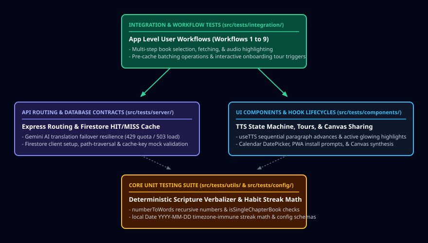

# Test Architecture and Coverage Strategy

---

## 1. Test Architecture Overview

The **Daily Devotionals Reader** is tested through a highly resilient, isolated, and deterministic multi-tier automated test suite utilizing **Vitest**, **React Testing Library**, and **Supertest**. 

### 📋 Test Coverage Summary
- **Total Automated Test Files**: `13`
- **Total Executed Tests**: `87`
- **Execution Success Rate**: `100% (Passed)`
- **Avg. Run Duration**: `~6.5s`

---

## 2. Major Test Categories and Coverage Matrix

> 📊 **Full Tabular Coverage Spreadsheet**: For a detailed, behavior-by-behavior mapping of application requirements to automated tests, view the [Comprehensive Test Coverage Matrix](test-coverage-matrix.md).

### Category 1: Core Unit Utilities
- **Location**: `src/tests/utils/` and `src/tests/config/`
  - `numberToWords`: Word synthesis for numbers `0` to `999`.
  - `replaceNthWord`: Precise case-preserving homograph overrides with regex escaping.
  - `isSingleChapterBook`: Exact case-insensitive matching for Jude, Obadiah, etc.
  - `verbalizeBook`: Normalization of abbreviations and ordinal numbers.
  - `verbalizeScripture`: Citation parsing for complex ranges and custom Psalm formatting.

### Category 2: Spiritual Streak Mathematics (Business Rules)
- **Location**: `src/tests/utils/date.test.ts`
  - Streak preservation on consecutive reading days (Yesterday + Today = Streak Incremented).
  - Streak preservation on multiple reads today (Idempotency check).
  - Streak reset to `0` if more than 24 hours pass since last reading.
  - Graceful recovery and fallback to `0` when encountering corrupted local storage payloads.

### Category 3: Speech Audio Engine and Hook state transitions
- **Location**: `src/tests/hooks/useTTS.test.ts`
  - State machine transitions from `Idle` -> `Playing` -> `Paused` -> `Resumed` -> `Stopped`.
  - Sequential paragraph advancing using `onend` utterance queue callbacks.
  - Complete reading callback triggers streak incrementation upon finished reading.
  - Profile-specific voice parameters (e.g., pitch `1.1` for `kids_primary` style).

### Category 4: Guided Onboarding Tours
- **Location**: `src/tests/components/Tour.test.tsx`
  - First-time installation auto-triggers the onboarding tour after a short delay.
  - Version upgrade semver checks (gating the tour from repeating).
  - Component skip-handling when DOM targets are hidden.

### Category 5: Canvas Graphics Synthesis Studio
- **Location**: `src/tests/components/ShareImageCardModal.test.tsx`
  - Aspect ratio adjustment (`1:1` square vs `9:16` vertical stories).
  - Copying quote text to system clipboard when CORS limits exports.

### Category 6: Server Routes and Gemini AI Resilience
- **Location**: `src/tests/server/api.test.ts` and `src/tests/server/api_additional.test.ts`
  - Firestore Cache Hit returning localized database rows.
  - Gemini AI quota exhaustion (`429`) failover to authentic classic text with warning.
  - Gemini AI overloaded (`503`) high-demand failover.
  - Malformed JSON schema response format corrections.

### Category 7: Multi-Step End-to-End Workflows
- **Location**: `src/tests/integration/`
  - **Workflow 2: Style Switch**: Switching profiles triggers state change and refetches content.
  - **Workflow 3: Date Traversal**: Prev/Next buttons adjust date prefixes and fetch historical devotionals.
  - **Workflow 5: Theme Presets**: Adjusting light/dark environmental themes persists configurations.
  - **Workflow 6: Download Caching**: Caching triggers background requests with cancellation capabilities.
  - **Workflow 8: Network Recovery**: Clicking retry successfully re-initializes broken panels.

### Category 8: UI Component Library Integration
- **Location**: `src/tests/components/components.test.tsx` and `src/tests/components/ui_additional.test.tsx`
  - **BookCover**: Procedural leather-bound CSS fallback on image loads, offline CACHED metrics, and download triggers.
  - **ReaderPanel**: Highlight overlays on active speaking paragraphs, completion flags, and reset book statuses.
  - **TTSPlayer**: Speech rate selectors, play/pause controls, and disabled properties on bounds.
  - **CalendarPicker**: Navigation calendar grids, popover modals, and resetting selection to today.
  - **Header & Sidebar**: Themes updates, responsive styling, and brand representation vectors.

---

## 3. Critical Regression Risks Covered

1. **Timezone Drift (Critical)**: Localized browser date formats are utilized exclusively.
2. **Infinite 365 Pre-Cache Loops**: Pre-cache downloads incorporate cancel hooks that halt requests instantly upon hitting the `CANCEL` trigger.
3. **ComboBox Collisions**: Select inputs query elements explicitly using DOM `id` properties.
4. **Logical OR Throw Exceptions**: Replaces `getByText` with `queryByText` inside error handling logical OR operations, bypassing throwing exceptions.

---

## 4. Known Limitations and Remaining Gaps
- **Native Speech Engine**: The Web Speech Synthesis API is mocked at the window layer. Real device voice outputs depend on native OS voice indexes.
- **Offline Service Workers**: SW stale-while-revalidate interception requires a real browser sandbox (Playwright) to intercept network-level requests.
